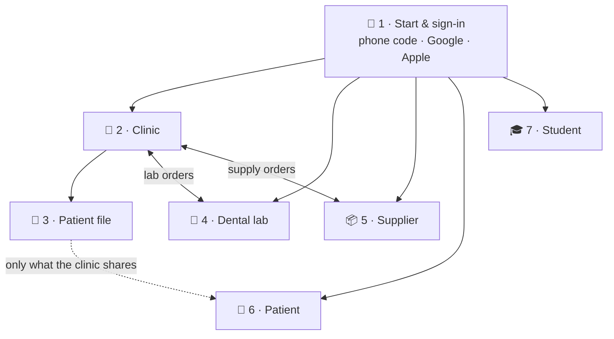
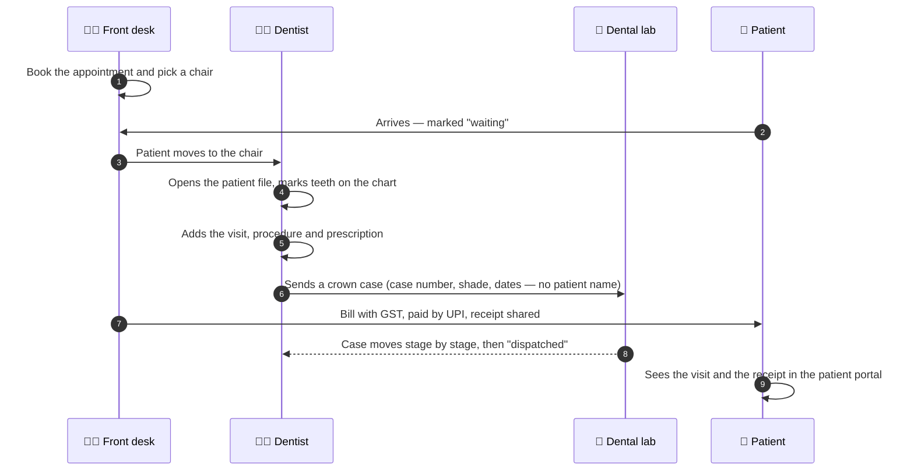
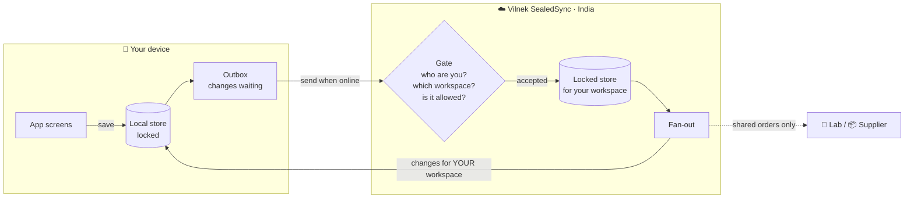
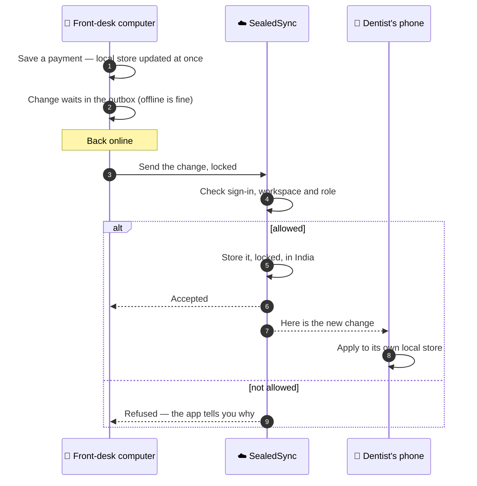

<div align="center">

# 🦷 iDentist.Live

### One dental app for the clinic, the lab, the supplier, the patient and the student

**Free · Works offline · Data kept in India · Made in India by a dentist**

[](https://identist.live)
[](https://play.google.com/store/apps/details?id=com.identist.vilnek)
[](https://apps.apple.com/in/app/id6819952240)
[](LICENSE)

[How the app works](#-how-the-app-works) · [A day in the clinic](#-a-day-in-the-clinic) · [How sync works](#-how-sync-works--vilnek-sealedsync) · [Safety](#-how-your-data-stays-safe) · [What is here](#-what-is-here) · [Open source plan](#-open-source-plan)

</div>

---

## 👋 What is iDentist.Live?

iDentist.Live is **one app** that runs on **Android, iPhone and iPad, Mac, Windows and the web**. A dentist, a front-desk person, a dental lab, a supplier, a patient and a dental student all use the same app, and each sees their own workspace.

- 🏥 **Clinics** run appointments, patient files, bills, stock and staff.
- 🧪 **Dental labs** receive cases from clinics and track every stage until delivery.
- 📦 **Suppliers** take orders from clinics and send GST invoices.
- 👤 **Patients** see their own visits, receipts and consents.
- 🎓 **Students** get a free library and a BDS-to-PhD knowledge base.

It keeps working when the internet drops, and every device of the clinic catches up by itself when it comes back.

---

## 🧭 How the app works

The app is built from **seven connected parts**. Sign-in opens the right workspace, and the workspaces talk to each other only where they need to.



| Part | Workspace | What you do there |
|:---:|---|---|
| **1** | 🔑 **Start and sign-in** | Sign in with your phone number (one-time code) or a Google or Apple account. Dentists are checked against the dental register. If you belong to more than one clinic, lab or shop, pick the workspace to open. |
| **2** | 🏥 **Clinic** | Appointments and chairs, the waiting room, bills and receipts, expenses, stock, the fee list, staff and their rights, lab works sent out, buying supplies, and reports. |
| **3** | 🦷 **Patient file** | One file per patient with seven tabs: dental chart (FDI tooth numbers), profile and medical history, visits, procedures, prescriptions, images (photos and X-rays) and payments. Consent is signed on screen. |
| **4** | 🧪 **Dental lab** | Cases come in from clinics and move across a production board: received → design → milling or printing → finishing → quality check → dispatched. Rate cards, delivery challans and clinic statements. |
| **5** | 📦 **Supplier** | Product catalogue, orders from clinics, dispatch, GST invoices and order tracking. |
| **6** | 👤 **Patient** | Patients sign in with their own phone number and see, read-only, what their clinic shares: visits, receipts and consents. They can give or withdraw consent. |
| **7** | 🎓 **Student** | A free dental library and a BDS-to-PhD knowledge base. |

### 🔐 Who can do what

Every person has a **role** in each workspace: owner, admin, dentist, staff and so on. The app shows only the screens your role allows, **and** the data platform checks the role again on every change, so hiding a button is never the only lock. When a staff member leaves, they lose access on all their devices the next time those devices connect.

---

## 📅 A day in the clinic

This is how the parts work together on a normal day.



Every step above is saved on the device first, so the clinic never waits for the network.

---

## 🔄 How sync works — Vilnek SealedSync

**Vilnek SealedSync** is the secure data platform behind the app. It keeps every device of a clinic up to date, even when some of them are offline, and keeps one clinic's data apart from every other clinic's.

> The diagrams below show the **idea**. They are deliberately not a map of our real servers, addresses or interfaces.



### Step by step



1. **You save.** The change goes into the **local store on your device** straight away, so the screen updates at once, online or not.
2. **It waits in the outbox.** Closing the app or losing the network does not lose it.
3. **It is locked before it leaves.** Private details are locked on the device, so nothing readable travels over the network.
4. **The gate checks it.** SealedSync checks that you are signed in, that the change belongs to a workspace you are a member of, and that your role allows it. If not, the change is refused and the app tells you.
5. **It is stored locked, in India,** in your workspace's own area, with a live copy so a fault in one place does not lose the clinic's work.
6. **Other devices catch up.** Every other device of the same workspace receives the change. A device that was off for days receives everything it missed when it comes back.
7. **Shared work crosses only what it must.** A lab or supplier receives only the **order**: the work, shade, dates and price, with a case number instead of the patient's name. The patient file never leaves the clinic.
8. **Patients see a read-only view** of only what the clinic shares with them.

### When two people change the same thing

Each change carries who made it and when, and SealedSync applies changes in order. Some facts are locked once set: the type of a workspace, the business a case was sent to, or who placed an order. Every step of an order, from "received" to "dispatched", is **added as a new entry**, never rewritten, and an audit trail records who did what.

### When the connection is bad

| Situation | What happens |
|---|---|
| 📶 Slow or no network | The app keeps working from the local store; the outbox grows; nothing is lost |
| ✅ Back online | The outbox is sent in order, then the device receives what it missed |
| 📱 New phone | Sign in, pick the workspace, and the device fills its local store |
| 🚫 Lost or stolen phone | The clinic owner removes that device or person; it can no longer send or receive |

---

## 🛡️ How your data stays safe

| Layer | What it means for a clinic |
|---|---|
| 🔒 **Locked on the device** | The local store is locked, and its keys sit in the phone's or computer's secure key storage |
| 🔐 **Locked on the way** | All traffic uses secure connections, and private details are locked before they travel |
| 🏦 **Locked in the cloud** | Each workspace is locked separately; people who run the servers cannot read patient files |
| 🧱 **One clinic, one area** | Every change is checked against its workspace, so one clinic can never read another's data |
| 🤏 **Least sharing** | Labs and suppliers see orders, not patient files; patients see only what their clinic shares |
| 🇮🇳 **Data in India** | Clinic data is stored in India |
| ✍️ **Your consent** | Patients give and withdraw consent in the app; accounts can be deleted at [identist.live/delete-account](https://identist.live/delete-account.html) |

We follow the Digital Personal Data Protection Act 2023 and the Information Technology Act, including CERT-In directions.

> **Why the server details are not here.** For a live medical platform, publishing server addresses, interfaces, database layouts or key handling would help an attacker more than a reader. So this repository explains **what** SealedSync does and keeps **how our live servers are built** private. No real clinic, patient or server data has ever been, or will ever be, in this repository.

---

## 📁 What is here

```
iDentist/
├── README.md          ← this guide
├── LICENSE            ← MIT License
└── app/               ← the iDentist.Live look for Flutter
    ├── lib/
    │   ├── theme/     ← colours, glass theme, phone/tablet/desktop sizes
    │   ├── panels/    ← glass panels, pop-ups, form and detail dialogs
    │   ├── pickers/   ← date, date-range and time pickers
    │   ├── money/     ← rupee fields and figures
    │   ├── notices/   ← top notices, "could not save" banner
    │   ├── dental/    ← dental product glyphs, lab and supplier categories
    │   ├── brand/     ← start screen, wordmark, avatars
    │   └── fonts/     ← Outfit, Noto Sans, Noto Sans Gujarati (SIL OFL)
    └── test/          ← 54 widget tests
```

See [app/README.md](app/README.md) to use it in your own Flutter project. There is no website, server code, data code, key or data here.

---

## 🗺️ Open source plan

| Step | What opens | Status |
|:---:|---|---|
| **1** | 📖 **This guide** — how the app and Vilnek SealedSync work | ✅ Open |
| **2** | 🎨 **The app's look** (`app/`) — theme, panels, pickers, notices, dental glyphs | ✅ Open |
| **3** | 🦷 **Dental tools** — FDI tooth chart, rupee and date formats, GST and bill sums, lab stages | 🔜 Planned |
| **4** | 🔄 **SealedSync demo** — the local store → outbox → sync idea on one computer with made-up data; it talks only to itself, never to the live platform | 🔜 Planned |
| **5** | 📱 **Demo app** — the app's screens running on made-up sample data, with no sign-in to the live system | 🔜 Planned |

**Every release passes the same check:** copied from an allow-list with fresh history · comments, internal names and addresses removed · made-up data only · automatic scan for keys, passwords, server names and personal data · pushed only after the owner says yes.

### 🚫 What will never be public

- The live servers of Vilnek SealedSync: code, addresses, interfaces and settings
- Database layouts and the names of stored tables and fields
- Keys, passwords, tokens and certificates, and how they are kept
- Deployment, backup and recovery setups
- Any real clinic, patient, lab, supplier or student data, or a screenshot that shows it
- App store signing files, internal documents, the website and its blog

---

## 🤝 Contributing and security reports

- Questions and fixes are welcome as issues or pull requests.
- 🔐 **Found a security problem?** Please do not open a public issue. Email **info@identist.live** with the subject "Security".
- Please never put real patient or clinic information in an issue, pull request or test.

---

<div align="center">

**info@identist.live** · Vilnek Private Limited, Surat, India

The code is under the [MIT License](LICENSE); the fonts keep their own SIL Open Font License.<br/>
"iDentist.Live", the iDentist tooth logo, "Vilnek" and "Vilnek SealedSync" are trademarks of Vilnek Private Limited and are not covered by the code licence.

**Made in India 🇮🇳 Made for India**

</div>
